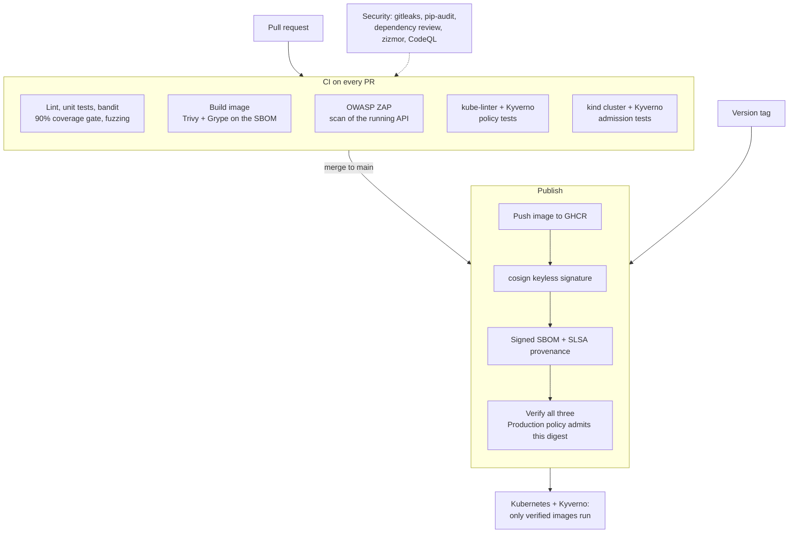

# Secure-supply-chain

[](https://github.com/Abhirup-code/Secure-supply-chain/actions/workflows/ci.yml)
[](https://github.com/Abhirup-code/Secure-supply-chain/actions/workflows/security.yml)
[](https://github.com/Abhirup-code/Secure-supply-chain/actions/workflows/codeql.yml)
[](https://scorecard.dev/viewer/?uri=github.com/Abhirup-code/Secure-supply-chain)
[](LICENSE)

A small link-shortener API delivered through a **hardened DevSecOps pipeline**. Every change is linted, tested, and scanned (code, secrets, dependencies, container, running app). Every published image is **signed, with a signed SBOM and build provenance**, and a **Kubernetes admission policy refuses to run anything the pipeline did not sign**. CI proves that last part in a real cluster on every pull request.

The app is intentionally small. The point of the project is the pipeline and the security controls around it.

## How it fits together



## Proof it works

### The cluster refuses anything the pipeline did not sign

The `Admission control in a real cluster` CI job starts a throwaway Kubernetes cluster with Kyverno, then tries to deploy:

| Scenario | Result |
|---|---|
| Image signed by the pipeline, with signed SBOM and provenance | Admitted, pinned to the signed digest, healthy |
| Unsigned image | Denied |
| Image signed with someone else's key | Denied |
| Signed image with no build provenance | Denied |
| Provenance that names a different repository | Denied |
| Release tag moved to different, unsigned content | Denied (the running app stays on the signed digest) |
| Public image (`nginx`) in the app namespace | Denied |
| Signed image, but the pod asks for privileged mode | Denied |

The job writes this table to its run summary every time it runs. See [scripts/admission-test.sh](scripts/admission-test.sh).

### Fuzzing found real bugs the unit tests missed

The first runs of the Atheris fuzz test ([fuzz/fuzz_links.py](fuzz/fuzz_links.py)) found four bugs. Each one is fixed and has a regression test:

| Input the fuzzer found | Problem | Fix |
|---|---|---|
| `http://localhost。`, full-width `ｌｏｃａｌｈｏｓｔ`, `１２７.0.0.1`, `169.254.169.254。` | **Blocklist bypass:** look-alike Unicode hostnames that browsers turn into internal addresses (including cloud metadata) were accepted | Check the IDNA-normalized hostname |
| A URL with a newline or tab inside it | Stored links broke the redirect (a header-injection attempt) | Reject control characters |
| A JSON body of `1` or `[]` | Server error (500) | Require a JSON object |
| `http://example.com℀`, `https://example.com:e` | Server error (500) on parsing, or a stored link that could not be followed | Reject unparseable hosts and ports |

After the fixes, an 8-minute run of over 500,000 inputs found nothing. CI fuzzes for 5 minutes on every pull request.

### A leaked key never becomes an image

I tested my own pipeline by committing a fake AWS key. The secret scanner and the SAST lint both caught it, and the build stopped before an image was ever created.


### Branch rules on main

With the `protect-main` ruleset on, changes reach `main` only through a pull request with passing checks.


## Security controls

| Area | Control |
|---|---|
| Admission (Kubernetes) | Kyverno `ImageValidatingPolicy`: only images signed by this repo's publish workflow (keyless, GitHub OIDC identity), with a signed SPDX SBOM and SLSA provenance naming this repo; tags pinned to the verified digest. `ValidatingPolicy`: only this project's image in the app namespace; pods must be non-root, unprivileged, drop all capabilities, use seccomp, a read-only root filesystem, and resource limits |
| Kubernetes manifests | Restricted Pod Security Standard on the namespace, default-deny NetworkPolicy, no service account token; kube-linter with all built-in checks |
| Image integrity | cosign keyless signature, signed SBOM (syft, SPDX), SLSA build provenance (GitHub artifact attestations), all verified in CI before the image is trusted |
| Vulnerabilities | Trivy (image and config) and Grype (on the SBOM) fail the build on fixable HIGH or CRITICAL issues; accepted risks need a written reason in [.grype.yaml](.grype.yaml) |
| Fuzzing | Atheris (coverage-guided) runs 5 minutes on every PR, checking that the app never crashes and never stores an unsafe link |
| Running app (DAST) | OWASP ZAP API scan of the live container from the [OpenAPI spec](docs/openapi.yaml); injection, XSS, and path traversal findings fail the build |
| Workflow token | Default `contents: read`; write scopes only in the publish job |
| Third-party code | Actions pinned to full commit SHAs; downloaded tools pinned and checksum-verified ([scripts/install-tools.sh](scripts/install-tools.sh)); Python dependencies pinned with hashes |
| Secrets | gitleaks on every push and PR; no long-lived signing keys |
| Code | ruff security rules, bandit, CodeQL security-extended, zizmor for workflows |
| Container | Multi-stage build, fixed non-root UID, read-only filesystem, all capabilities dropped, `no-new-privileges`, health check |
| Releases | Version tags publish a signed image and a GitHub Release with the SBOM and verify commands; tags must point at a commit already on `main` |
| App | http/https allowlist, blocks internal and private addresses, parameterized SQL, unguessable codes, per-IP rate limiting, CSP and security headers |

See [docs/THREAT_MODEL.md](docs/THREAT_MODEL.md) for the STRIDE threat model and [SECURITY.md](SECURITY.md) for how to verify an image yourself.

## Run locally

```bash
pip install --require-hashes -r requirements-dev.txt
pytest --cov=app
ruff check . && bandit -c pyproject.toml -r app
```

```bash
pip install --require-hashes -r requirements-fuzz.txt
PYTHONPATH=. python fuzz/fuzz_links.py -max_total_time=60   # fuzz for a minute
```

```bash
docker compose up --build   # http://localhost:8000
curl -X POST -H 'Content-Type: application/json' -d '{"url":"https://example.com"}' localhost:8000/api/links
```

Policy and manifest checks (Linux; downloads pinned, checksum-verified tools into `./bin`):

```bash
scripts/install-tools.sh kube-linter kyverno
bin/kube-linter lint --config .kube-linter.yaml k8s/app
bin/kyverno test k8s/policies/tests
```

## Deploy to Kubernetes

```bash
# 1. Install Kyverno, then the policies
helm install kyverno kyverno/kyverno -n kyverno --create-namespace
kubectl apply -k k8s/policies
# 2. Deploy the app (the policies verify the image before it starts)
kubectl apply -k k8s/app
```

## API

Full spec: [docs/openapi.yaml](docs/openapi.yaml)

| Method | Path | Description |
|---|---|---|
| POST | `/api/links` | Create a short link from `{"url": "https://..."}` (rate limited, default 30/minute per IP via `RATE_LIMIT_PER_MINUTE`) |
| GET | `/{code}` | Redirect to the original URL (302) and count the hit |
| GET | `/api/links/{code}` | Link details and hit count |
| DELETE | `/api/links/{code}` | Delete a short link (204, or 404 if unknown) |
| GET | `/health` | Health check |

## Releasing

```bash
git tag v1.0.0
git push origin v1.0.0
```

The Release workflow checks that the tag is on `main`, publishes a signed `:v1.0.0` image with its SBOM and provenance, and creates a GitHub Release with the SBOM attached.

## Updating dependencies

Dependencies are locked with hashes. Edit the `.in` file, then regenerate the lock file:

```bash
pip install uv
uv pip compile requirements.in --universal --python-version 3.14 --generate-hashes -o requirements.txt
uv pip compile requirements-dev.in --universal --python-version 3.14 --generate-hashes -o requirements-dev.txt
```

## Recommended repository settings

1. Settings > Code security: enable Dependabot alerts, Secret scanning, Push protection, Private vulnerability reporting.
2. Settings > Rules > Rulesets: protect `main` (require a pull request and passing CI, Security, and CodeQL checks).
3. Settings > Actions > General: Workflow permissions = "Read repository contents".

## License

[Apache License 2.0](LICENSE). Copyright 2026 Abhirup Khan; see [NOTICE](NOTICE).
